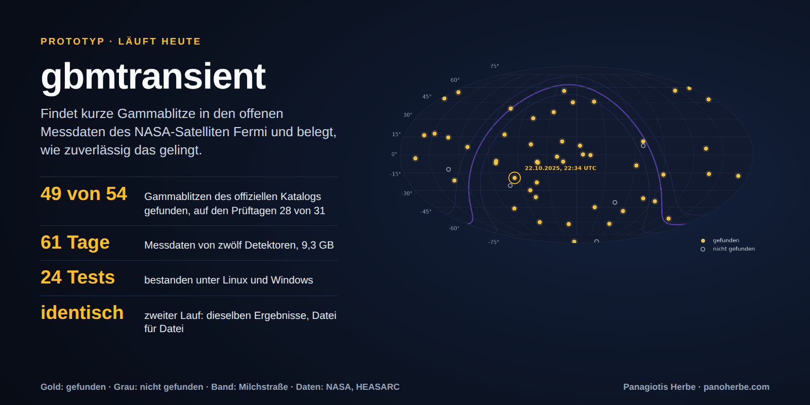
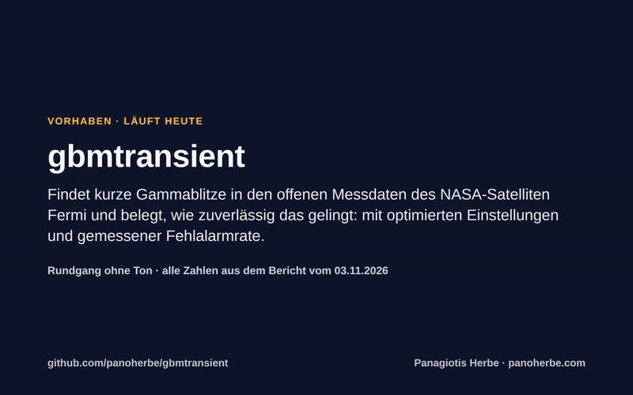
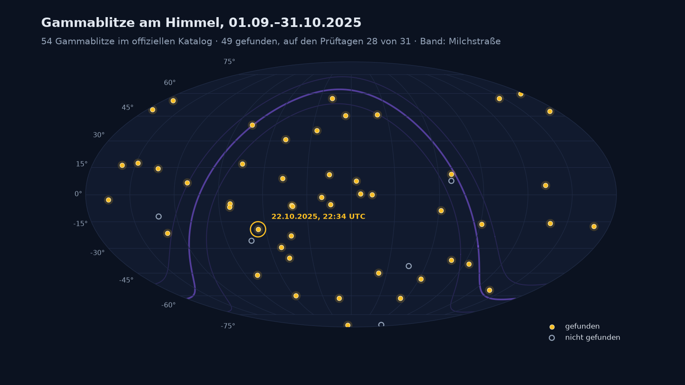
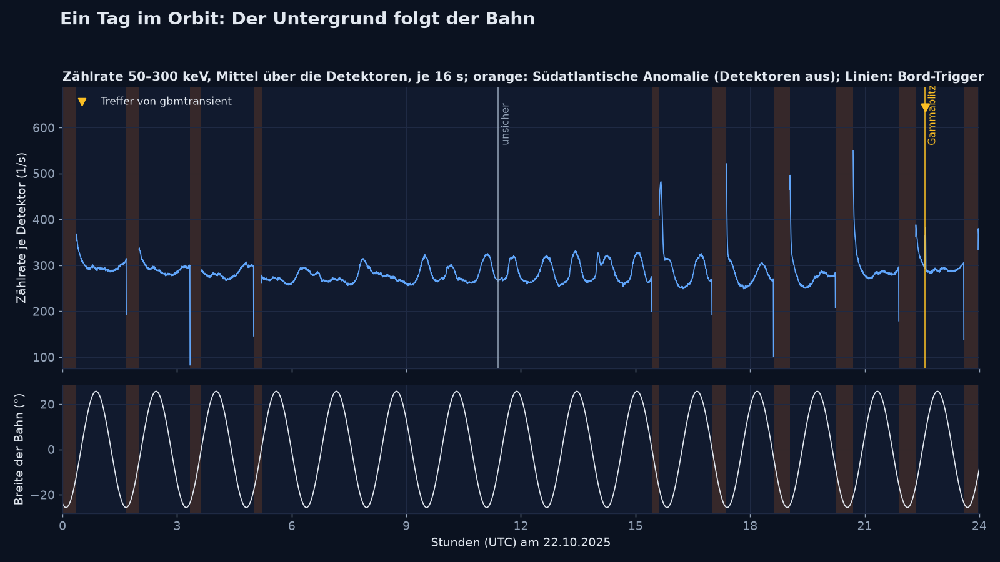
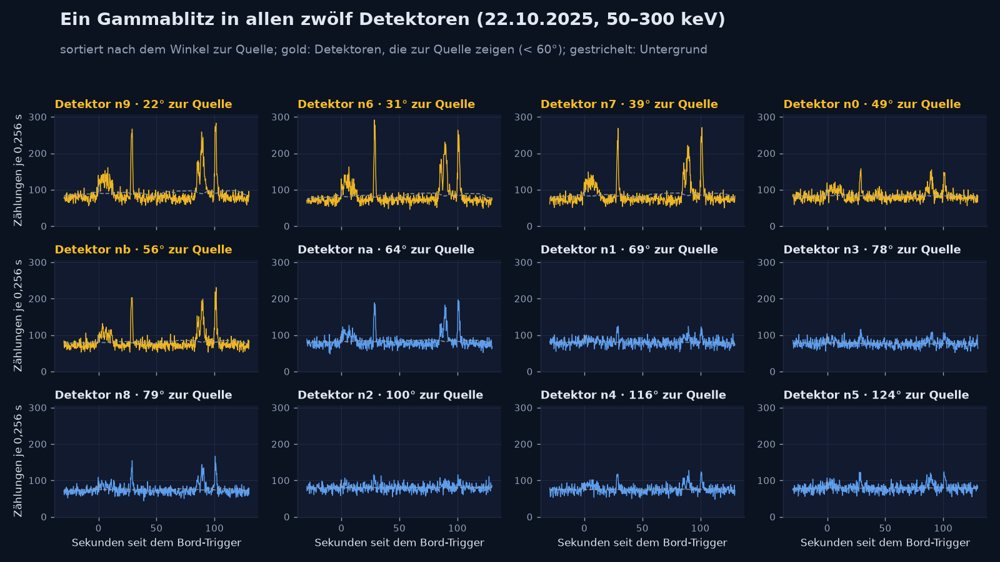
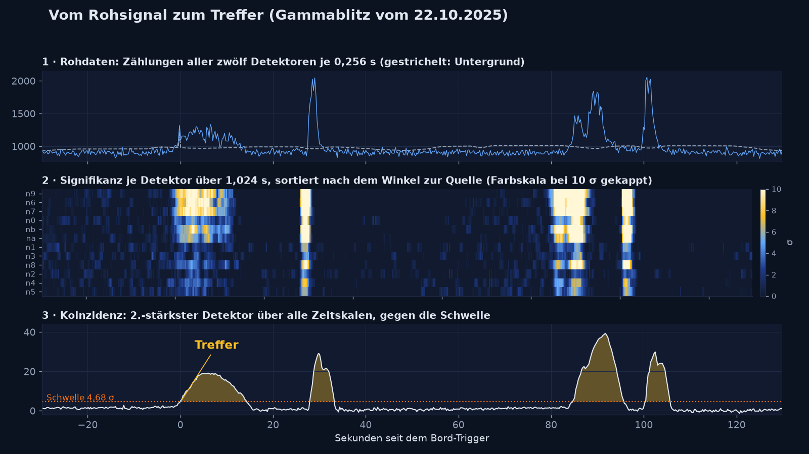
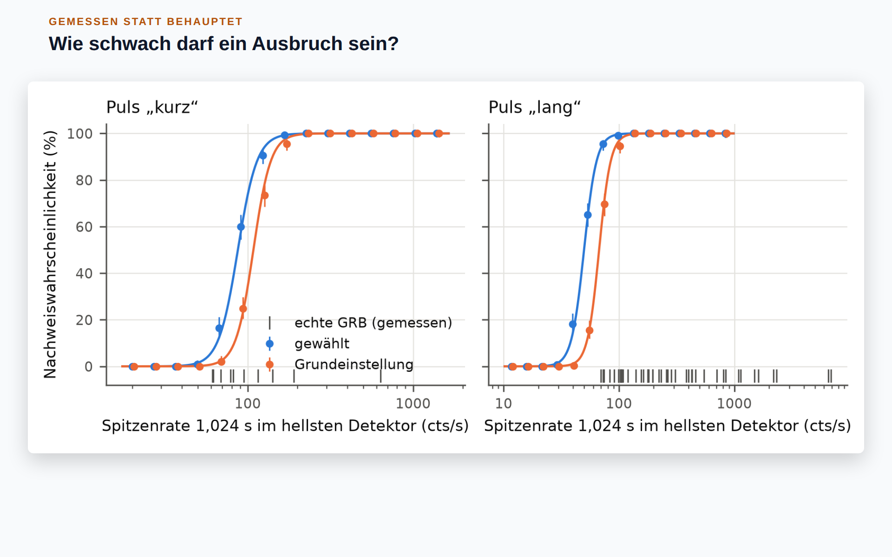
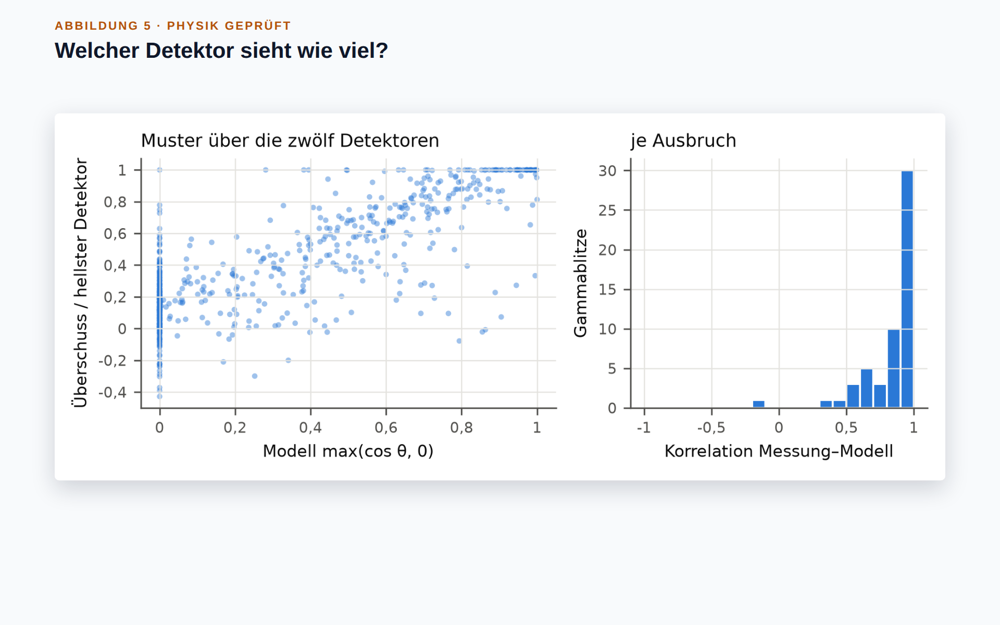

# gbmtransient

**Ein Programm findet kurze Gammablitze in den offenen Messdaten des NASA-Satelliten Fermi, wählt seine
Einstellungen per Optimierung und belegt seine Trefferquote am offiziellen Katalog: 49 von
54 Gammablitzen gefunden, auf den Prüftagen 28 von 31.** Es läuft heute: ausgewertet am 03.11.2026 auf 61 Tagen Messdaten
von zwölf Detektoren, 24 Tests bestanden unter Linux und Windows.

*Finds short gamma-ray bursts in open NASA Fermi GBM data with an optimised, statistically calibrated trigger and
measures its hit rate against the official catalogue. Documentation in German. Not affiliated with NASA.*

## Was das zeigt

Gammablitze sind die hellsten bekannten Explosionen im All: Sekundenbruchteile bis Minuten lang, aus allen Richtungen
des Himmels. Der Gamma-ray Burst Monitor (GBM) an Bord des NASA-Satelliten Fermi beobachtet sie seit 2008 mit zwölf
Szintillationsdetektoren, die in verschiedene Richtungen zeigen. Die Messdaten sind offen: Zählraten alle 0,256
Sekunden, mitten in einem Untergrund, der mit der Bahn um die Erde schwankt.

gbmtransient sucht darin Ausbrüche, wie es ein Prüfdienst in jedem Messnetz tun müsste: Es bewertet jeden Detektor
statistisch, verlangt, dass mehrere Detektoren zugleich anschlagen, misst die Rate zufälliger Fehlalarme und wählt
seine Einstellungen per Optimierung, auf einem Teil der Tage gewählt und auf den übrigen geprüft. Ob das trägt,
entscheidet eine unabhängige Referenz: der offizielle Triggerkatalog des GBM. Jede Zahl auf dieser Seite stammt aus
der Ergebnisdatei des Laufs; Grenzen und Fehlschläge stehen im Bericht.

Der Verfasser hat 2020 in seiner Masterarbeit in Zusammenarbeit mit der NASA, als Gastwissenschaftler am Marshall
Space Flight Center (Fermi-GBM-Team), an der Erkennung von Röntgenausbrüchen in den Messdaten desselben Instruments
gearbeitet. Dieses Vorhaben ist davon unabhängig: eigene Fragestellung, eigener Code, Messdaten von 2025.

## Rundgang (75 Sekunden, ohne Ton, mit Untertiteln)



[Video herunterladen (MP4, 1,0 MB)](medien/rundgang.mp4) · [Standbild](medien/poster.png)

<details><summary>Untertitel als Text</summary>

- **0:00** Prototyp · läuft heute. gbmtransient findet kurze Gammablitze in den offenen Messdaten des NASA-Satelliten Fermi und belegt, wie zuverlässig das gelingt: mit optimierten Einstellungen und gemessener Fehlalarmrate.
- **0:05** Worum es geht: Gammablitze sind die hellsten bekannten Explosionen im All, Sekundenbruchteile bis Minuten lang. Der NASA-Satellit Fermi beobachtet seit 2008 mit zwölf Detektoren den ganzen Himmel, den die Erde nicht verdeckt. Ausgewertet: 61 Tage (01.09. bis 31.10.2025), 793 Dateien, 9,3 GB.
- **0:11** Alle 54 Gammablitze aus dem offiziellen Katalog erscheinen in zeitlicher Folge am Himmel: gold, wenn gbmtransient sie findet.
- **0:16** 49 von 54 gefunden, auf den Prüftagen 28 von 31. Das Band ist die Milchstraße; Gammablitze kommen aus allen Richtungen.
- **0:20** Ein Tag im Orbit: Die Zählrate schwankt mit der Bahn um die Erde; über dem Südatlantik schalten die Detektoren ab. Darin muss ein Ausbruch von Sekunden gefunden werden.
- **0:26** Ein Gammablitz am 22.10.2025: Die Detektoren, die zur Quelle zeigen, sehen ihn deutlich, die abgewandten kaum. Genau dieses Muster nutzt das Verfahren.
- **0:32** Vom Rohsignal zum Treffer: Signifikanz je Detektor, dann die Koinzidenz über die Detektoren.
- **0:38** Liegt der zweitstärkste Detektor über der Schwelle von 4,68 σ, meldet gbmtransient einen Treffer; hier mit bis zu 39 σ.
- **0:42** 21.805 künstliche Ausbrüche bekannter Stärke eingebaut und wiedergesucht: Die optimierte Einstellung findet die Hälfte schon ab 87 statt 108 Zählungen pro Sekunde (kurze Pulse), ab 50 statt 67 (lange).
- **0:49** Erst die Tests: 24 von 24 bestanden, ebenso unter Windows in der automatischen Prüfung.
- **0:52** Dann ein Befehl für alle 61 Tage, nur aus der unveränderten Rohablage.
- **0:55** Zur Kontrolle ein zweiter Lauf mit anderer Aufteilung auf die Prozessoren: alle Ergebnisse identisch.
- **0:59** Was nachgewiesen ist: 49 von 54 Gammablitzen gefunden, auf den Prüftagen 28 von 31; 61,2 % der künstlichen Ausbrüche erkannt statt 55,6 %; 24 Tests unter Linux und Windows; zweiter Lauf identisch.
- **1:05** Ehrlich gesagt: 0,33 statt 0,1 zufällige Fehlalarme je Tag an den Prüftagen; 5 Gammablitze verpasst, meist sehr kurze; 80 Meldungen ohne Katalogeintrag, nicht geprüft; Detektormodell vereinfacht.
- **1:11** Selbst prüfen: Code, Bericht, Testprotokoll und Abrufliste liegen offen. Lizenz: AGPL-3.0.

</details>

## Bilder

| | |
|---|---|
|  |  |
| **Zwei Monate Himmel.** Alle 54 Gammablitze des offiziellen Katalogs vom 01.09. bis 31.10.2025 in Himmelskoordinaten: 49 findet gbmtransient (gold), 5 nicht (grau); auf den Prüftagen 28 von 31. Das violette Band ist die Milchstraße. | **Ein Tag im Orbit.** Die Zählrate folgt der Bahn um die Erde (unten ihre Breite); über dem Südatlantik sind die Detektoren aus (orange). Der Gammablitz um 22:34 UTC ist ein kurzer Ausschlag darin. |
|  |  |
| **Zwölf Detektoren, ein Ausbruch.** Der Gammablitz vom 22.10.2025 in allen Detektoren, sortiert nach dem Winkel zur Quelle: Die zur Quelle zeigenden (gold) sehen ihn deutlich. | **Vom Rohsignal zum Treffer.** Rohzählungen, Signifikanz je Detektor (Farbskala bei 10 σ gekappt), Koinzidenz mit der Schwelle von 4,68 σ; hier bis zu 39 σ. |
|  |  |
| **Gemessen statt behauptet.** 21.805 künstliche Ausbrüche bekannter Stärke wiedergesucht: Die optimierte Einstellung (blau) findet schwächere als die Grundeinstellung (orange). | **Physik geprüft.** Welcher Detektor wie viel sieht, folgt bei 54 Gammablitzen dem Modell der Detektorausrichtung (Korrelation im Median 0,92). |

## Was Sie brauchen → läuft hier schon

Gemessen am 03.11.2026 auf den Daten vom 01.09. bis 31.10.2025; Quelle jeder Zahl:
[`nachweis/2026-11-03/ergebnisse.json`](nachweis/2026-11-03/ergebnisse.json).

| Was Sie brauchen | Läuft hier schon |
|---|---|
| Auffällige Ereignisse in einem Verbund vieler Detektoren erkennen | Koinzidenz über zwölf Detektoren: 49 von 54 Gammablitzen des offiziellen Katalogs gefunden, auf den Prüftagen 28 von 31 (Tage, die nicht zur Wahl der Einstellung dienten); eine an den Bord-Trigger angelehnte Einstellung: 41 von 54, auf den Prüftagen 24 von 31 |
| Fehlalarme messen | Rate zufälliger Fehlalarme über Zeitverschiebungen gemessen; Grenzen je Tag als Nebenbedingung der Optimierung (an den Prüftagen überschritten, siehe „Ehrlich gesagt“) |
| Einstellungen begründet wählen statt raten | Optimierung über 162 Einstellungen, gewählt auf 31 Tagen, geprüft auf 30 anderen |
| Güte belegen statt behaupten | 21.805 künstliche Ausbrüche bekannter Stärke eingebaut und wiedergesucht: 61,2 % erkannt statt 55,6 % (Prüftage) |
| Zahlen, die jeder nachrechnen kann | 793 Rohdateien (9,3 GB) mit SHA-256 im Manifest; ein zweiter Lauf ergab dieselben Ergebnisse, Datei für Datei |
| Python unter Linux und Windows | 24 automatisierte Tests, bestanden in Docker unter Linux und in GitHub Actions unter Ubuntu und Windows (Python 3.11 bis 3.13) |

## In zwei Minuten selbst prüfen

1. **Bericht lesen:** [`nachweis/2026-11-03/BERICHT.pdf`](nachweis/2026-11-03/BERICHT.pdf), 8 Seiten, Testprotokoll in Abschnitt 8.
2. **Testlauf ansehen:** [GitHub Actions, Lauf 41718520863](https://github.com/panoherbe/gbmtransient/actions/runs/41718520863),
   sechs Jobs (Ubuntu und Windows, je Python 3.11, 3.12, 3.13), in jedem 24 von 24 Tests bestanden.
3. **Tests selbst ausführen** (Python ab 3.11, kein Netz nötig, rund 10 bis 30 Sekunden):

   ```bash
   git clone https://github.com/panoherbe/gbmtransient && cd gbmtransient
   pip install ".[plots,test]"
   python -m pytest tests
   ```

4. **Jede Zahl nachschlagen:** [`ergebnisse.json`](nachweis/2026-11-03/ergebnisse.json),
   [`katalog_abgleich.csv`](nachweis/2026-11-03/katalog_abgleich.csv) (jeder der 182 Katalogeinträge mit Ergebnis).

## Ihr Vorteil: Sie bewerten ein laufendes System, kein Versprechen

Das Verfahren ist gebaut, auf echten Messdaten ausgewertet und gegen eine unabhängige Referenz geprüft. Was es kann
und was nicht, steht in Zahlen im Bericht, einschließlich der Fehlschläge.

## Ehrlich gesagt

- **Zufällige Fehlalarme:** An den Prüftagen 0,33 je Tag statt der auf den Trainingstagen
  eingehaltenen 0,1. Eine Schwelle aus wenigen Wochen trägt die Schwankung von Tag zu Tag nicht; ein Betrieb
  bräuchte eine laufende Nachkalibrierung.
- **Verpasst:** 5 von 54 Gammablitzen, meist sehr kurze; für sie sind Daten mit 0,256 s
  Auflösung zu grob.
- **Nicht geprüft:** 80 Meldungen ohne Katalogeintrag in 61 Tagen, nur nach Merkmalen
  eingeordnet (Rand der Strahlungszone über dem Südatlantik, vermutlich schwache Sonneneruptionen, ohne Zuordnung).
- **Vereinfacht:** Das Modell der Detektoren (Kosinus, ohne Streuung); die Nachweisgrenzen gelten für dieses Modell.
- **Was ein Auftrag ergänzen würde:** Anpassung an die Daten und Meldewege des Auftraggebers, laufende
  Nachkalibrierung der Schwellen, Schutzabstand vor Datenlücken, Betrieb in Echtzeit.

## Lizenz

Ab 04.11.2026 AGPL-3.0 (`LICENSE`); frühere Stände bis Commit 7f6f31a Apache-2.0. Auftraggeber erhalten im Auftrag
die vertraglich vereinbarte Lizenz.

## Kontakt

Panagiotis Herbe · [panoherbe.com](https://panoherbe.com)

---

## Für die IT: Technik

### Was er kann

- **Rohdaten holen und unverändert ablegen:** CTIME-Tagesdateien der zwölf NaI-Detektoren (acht Energiekanäle,
  0,256 s), die Positionsdatei je Tag und den Trigger- und Burstkatalog des HEASARC (TAP-Abfrage). Jede Datei mit
  URL, SHA-256 und Abrufzeit in `manifest.jsonl`; ausgewertet wird nur aus der Ablage, jede Datei wird vor dem
  Lesen gegen ihre Prüfsumme geprüft.
- **Datenmodell:** gemeinsames Zeitraster (0,256 s) mit Zählungen und Lebenszeit je Zelle, Detektor und
  Energieband; feinere Intervalle nach Bord-Triggern, Übergänge und Lücken gehen mit ihrer echten Messzeit ein.
- **Signifikanz je Detektor:** Likelihood-Quotienten-Test für Poisson-Zählungen (Li & Ma 1983) gegen einen
  zweiseitigen oder kausalen Untergrund aus Nebenfenstern, für Zeitskalen von 0,256 bis 8,192 s.
- **Koinzidenz über Detektoren:** k-größte Signifikanz der zwölf Detektoren (Ordnungsstatistik).
- **Fehlalarmrate durch Zufall:** Zeitverschiebungen der Detektoren gegeneinander (jedes Paar mindestens 43 min
  versetzt).
- **Gütemessung:** künstliche Ausbrüche (Pulsform nach Norris et al. 2005, Detektorantwort ∝ cos θ) werden in die
  echten Zählungen eingebaut und wiedergesucht.
- **Optimierung:** höchste Nachweiswahrscheinlichkeit unter zwei Nebenbedingungen (zufällige Fehlalarme, Zahl
  unbestätigter Kandidaten je Tag), vollständige Suche über 162 Konfigurationen, Auswahl auf Trainingstagen,
  Bewertung auf Testtagen, Bootstrap-Stabilität.
- **Abgleich:** Wiederfindung der Bord-Trigger je Einordnung im Katalog, Prüfung des Antwortmodells an echten
  Gammablitzen, Einordnung unbestätigter Kandidaten nach Merkmalen.
- **Bericht:** `ergebnisse.json` (jede Zahl des Berichts), `BERICHT.md`, Abbildungen, CSV-Listen.

### Start

```bash
pip install ".[plots]"
gbmtransient holen --daten daten --von 2025-09-01 --bis 2025-10-31     # 793 Dateien, rund 10 GB
gbmtransient auswerten --raw daten/raw/<Abrufdatum> --aus nachweis/<Datum> --prozesse 10
```

Mit Docker: `docker compose run --rm gbmtransient holen --daten /daten --von … --bis …`, dann
`docker compose run --rm gbmtransient auswerten --raw /daten/raw/<Abrufdatum> --aus /nachweis/<Datum>`;
Tests: `docker compose run --rm test` oder `python -m pytest tests`.

### Nachweis

`nachweis/<Datum>/` enthält je Auswertung Bericht (Markdown und PDF), Kennzahlen, Abbildungen, Listen und
Testprotokoll. Die Tests laufen bei jedem Push in GitHub Actions unter Ubuntu und Windows (Python 3.11 bis 3.13).

- `nachweis/2026-11-03/`: Auswertung von 61 Tagen (01.09.–31.10.2025): `BERICHT.pdf` (8 Seiten, Testprotokoll in
  Abschnitt 8), `ergebnisse.json` (jede Zahl des Berichts), Abbildungen, `ereignisse.csv`, `katalog_abgleich.csv`,
  `konfigurationen.csv`, `tage.csv`, das Manifest der Rohablage und die Testberichte der CI (`ci/`).

### Grenzen

Vereinfachte Detektorantwort (Kosinus, ohne Streuung), zwei Pulsformen, ein Zeitraum von 61 Tagen; unbestätigte
Kandidaten sind nach Merkmalen eingeordnet, nicht geprüft. Der Prototyp zeigt Verfahren und Messmethodik; er ist
kein Ersatz für die Auswertung des GBM-Teams.

### Daten und Lizenzen

- Fermi GBM, HEASARC (NASA/GSFC): https://heasarc.gsfc.nasa.gov/FTP/fermi/data/gbm/daily/ und die Tabellen
  `fermigtrig`, `fermigbrst`. GBM-Daten waren zu keiner Zeit proprietär (Fermi Science Support Center, Fermi Data
  Policy); „HEASARC materials are all available freely for your use“ (HEASARC, Use of HEASARC Data).
- This research has made use of data and/or software provided by the High Energy Astrophysics Science Archive
  Research Center (HEASARC), which is a service of the Astrophysics Science Division at NASA/GSFC.

Die Rohdaten sind nicht Teil des Repositorys. Code: AGPL-3.0 (`LICENSE`, `NOTICE`), siehe „Lizenz“ oben.
