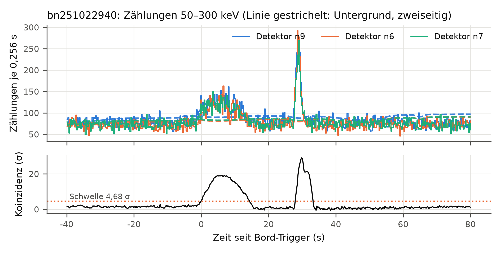
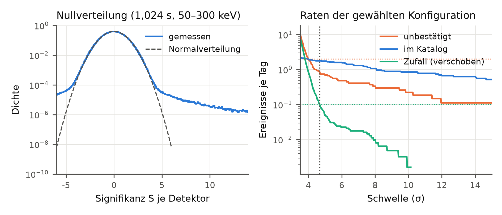
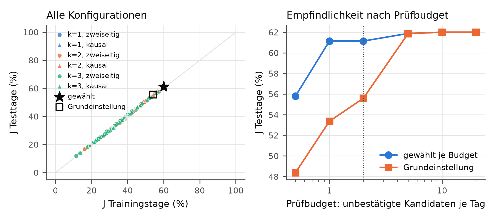
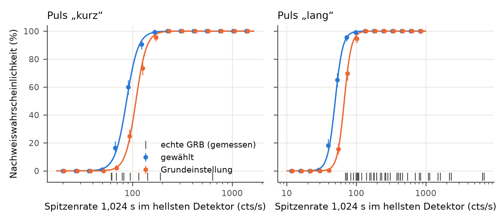
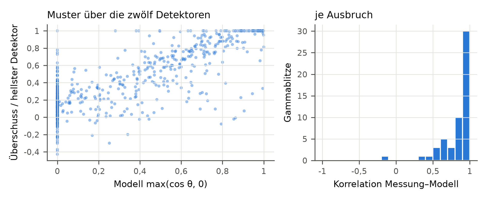

# gbmtransient – Suche nach kurzen Gamma- und Röntgentransienten in Messdaten des Fermi GBM

**Technischer Bericht, Version 0.1.0** · Vorhaben des Bieters Panagiotis Herbe · Auswertung vom
03.11.2026 · Quellcode, Tests und Rohdaten-Manifest:
https://github.com/panoherbe/gbmtransient

## 1 Zusammenfassung

Untersucht wird, wie empfindlich ein statistisch kontrollierter Trigger kurze Gamma- und Röntgenausbrüche in den
Zählraten der zwölf NaI-Szintillationsdetektoren des Fermi Gamma-ray Burst Monitor (GBM) findet, wenn seine
Parameter durch ein Optimierungsverfahren gewählt werden. Grundlage sind 61 Tage offener Messdaten
(01.09.2025 bis 31.10.2025,
793 Dateien, 9,3 GB, 1.274 h Messzeit). Unter
162 Trigger-Konfigurationen wurde auf 31 Trainingstagen die mit der höchsten
Nachweiswahrscheinlichkeit bei höchstens 0,1 zufälligen Fehlalarmen und höchstens
2 unbestätigten Kandidaten je Tag gewählt; bewertet wird auf den 30
übrigen Tagen.

- **Gewählt:** mindestens 2 Detektoren, Untergrund kausal (nur davor) je 32,8 s, Zeitskalen 0,256–4,096 s, Band 50–300 keV, Schwelle 4,68 σ.
- **Nachweiswahrscheinlichkeit künstlicher Ausbrüche (Testtage):** 61,2 % gegenüber 55,6 % für
  eine an den Bord-Trigger angelehnte Grundeinstellung bei denselben Nebenbedingungen; 50-%-Schwelle kurzer Pulse
  87 statt 108, langer Pulse 50
  statt 67 Zählungen/s.
- **Abgleich mit dem GBM-Triggerkatalog (alle Tage):** 91 % (49 von 54; 95-%-Intervall 80 %–96 %) der abgedeckten
  Gammablitze erkannt.
- **Fehlalarme (Testtage):** zufällig 0,33 je Tag (Trainingstage
  0,10; die Grenze 0,1 hält die Schwelle nur auf den Trainingstagen ein),
  unbestätigte Kandidaten 1,69 je Tag (Grenze 2).
- **Statistik geprüft:** Die Signifikanz je Detektor hat über alle Daten Mittel −0,009 und
  Streuung 1,012, wie für die Standardnormalverteilung erwartet (Abb. 2).

## 2 Fragestellung und Daten

Der GBM an Bord des Fermi-Satelliten (NASA, seit 2008) misst mit zwölf NaI(Tl)-Detektoren (8 keV bis 1 MeV) und
zwei BGO-Detektoren die Zählraten aus allen Richtungen, die nicht von der Erde verdeckt sind. An Bord löst ein
Trigger aus, wenn mindestens zwei NaI-Detektoren gleichzeitig eine Schwelle über dem Untergrund überschreiten. Jeder
Detektor zählt Photonen und ordnet ihre Energie in Kanäle ein; die Messung prägen die Totzeit (gemeldet als
Lebenszeit je Intervall), die Ausrichtung der Detektoren mit ihrer Winkelabhängigkeit und ein Untergrund, der sich
mit der Bahn ändert (geomagnetische Breite, Südatlantische Anomalie, Erde im Blickfeld). Die
Frage dieses Vorhabens: Wie weit lässt sich die Empfindlichkeit einer nachträglichen Suche in den kontinuierlichen
Daten steigern, wenn Untergrundschätzung, Zeitskalen, Energieband, Zahl der Detektoren und Schwelle gemeinsam
optimiert werden, und wie verlässlich ist das gegen den offiziellen Triggerkatalog? Der Verfasser hat 2020 in
seiner Masterarbeit mit Messdaten desselben Instruments gearbeitet (Erkennung von Röntgenausbrüchen); dieses
Vorhaben ist davon unabhängig: eigene Fragestellung, eigener Code, Messdaten von 2025.

| | |
|---|---|
| Messdaten | CTIME-Tagesdateien der zwölf NaI-Detektoren (acht Energiekanäle, 0,256 s; nach Bord-Triggern 0,064 s) und Positionsdatei (Lage, Südatlantische Anomalie, Sonne sichtbar) |
| Kataloge | Triggerkatalog `fermigtrig` (alle Bord-Trigger mit Einordnung und Quellrichtung) und Burstkatalog `fermigbrst` (Dauer T90, Fluss), Abfrage über TAP |
| Quelle | HEASARC, NASA Goddard Space Flight Center, `https://heasarc.gsfc.nasa.gov/FTP/fermi/data/gbm/daily/`; GBM-Daten waren nach der Datenpolitik der Mission zu keiner Zeit proprietär; „HEASARC materials are all available freely for your use“ (HEASARC, Use of HEASARC Data) |
| Rohablage | 856 Dateien, jede mit URL, SHA-256 und Abrufzeit im Manifest (SHA-256 des Manifests `d3c31cbacb4dbd0d…`); ausgewertet wird nur aus der Ablage, jede Datei wird vor dem Lesen geprüft |
| Zeitraum | 01.09.2025–31.10.2025; im Triggerkatalog 182 Bord-Trigger, davon 54 Gammablitze |
| Abdeckung | 87,0 % der Zeit mit Daten von mindestens sechs Detektoren; von 190 h ohne Daten liegen 99,7 % in Durchgängen durch die Südatlantische Anomalie (Kennung der Positionsdatei; die Detektoren sind dort abgeschaltet) |

## 3 Verfahren

**Datenmodell.** Je Tag ein gemeinsames Zeitraster mit Zellen von 0,256 s; je Detektor und Energieband
(27–50 keV, 50–300 keV) die Zahl der Ereignisse und die Lebenszeit (Messzeit ohne Totzeit) je Zelle. Jedes
CTIME-Intervall wird der Zelle seines Mittelpunkts zugeordnet; die feineren Intervalle nach Bord-Triggern und
Übergangsintervalle gehen mit ihrer echten Messzeit ein, Lücken sind Zellen mit Messzeit null. Alle Summen über
Fenster werden aus kumulierten Summen gebildet und tragen ihre Messzeit mit.

**Signifikanz je Detektor.** Für ein Signalfenster der Länge T (0,256 bis 8,192 s) wird der Untergrund aus
Nebenfenstern der Breite w geschätzt, zweiseitig (vor und nach dem Fenster; ein linearer Verlauf hebt sich heraus)
oder kausal (nur davor, wie an Bord und für Echtzeit-Alarme). Der Überschuss wird mit dem
Likelihood-Quotienten-Test für Poisson-Zählungen nach Li & Ma (1983) bewertet; das Verhältnis der Messzeiten
α = E_Signal / E_Untergrund berücksichtigt Lücken und Totzeit.

**Koinzidenz.** Die Teststatistik ist die k-größte Signifikanz über die zwölf Detektoren (Ordnungsstatistik):
„mindestens k Detektoren über s“ ist genau C_k ≥ s. Eine Konfiguration nimmt das Maximum über ihre Zeitskalen und
Bänder; Überschreitungen im Abstand bis 10,24 s bilden ein Ereignis. Ein Ereignis gilt als bestätigt, wenn ein
Katalog-Trigger zwischen 20 s vor seinem Beginn und 5 s nach seinem Ende liegt.

**Fehlalarmrate durch Zufall.** In 20 Durchläufen wird Detektor d zyklisch um d·φ eines Tages verschoben, mit
einem anderen φ je Durchlauf, so gewählt, dass jedes Detektorpaar mindestens 43 min gegeneinander versetzt ist
(Zeitverschiebungs-Methode). Echte Ausbrüche treffen alle Detektoren gleichzeitig und fallen dabei auseinander,
auch lange wie Sonneneruptionen; die verbleibenden Koinzidenzen schätzen die Rate zufälliger Fehlalarme aus 1.220
verschobenen Tagen. Die Rate unbestätigter Kandidaten im unverschobenen Lauf enthält dazu echte, nicht
getriggerte Ereignisse und korrelierten Untergrund.

**Künstliche Ausbrüche.** Alle 200 s (ohne Katalog-Trigger im Umkreis von 200 s und ohne Datenlücke) wird ein Puls
nach Norris et al. (2005) mit Poisson-Zählungen in die echten Daten eingebaut, 21.805 insgesamt:
„kurz“ (Breite etwa 0,4 s, Verhältnis 27–50 zu 50–300 keV angenommen 0,3) und „lang“ (etwa 10 s, 0,6), Stärke
log-gleichverteilt, Richtung isotrop, Zählrate je Detektor proportional zu max(cos θ, 0) zur Detektorachse
(Ausrichtungen nach Meegan et al. 2009); 5 % der Plätze bleiben leer (Kontrolle). Stärke = erwartete höchste
Überschussrate über 1,024 s im hellsten Detektor, 50–300 keV; dieselbe Größe wird an echten Ausbrüchen gemessen.

**Optimierungsverfahren.** Gesucht ist die Konfiguration mit der höchsten mittleren Nachweiswahrscheinlichkeit J
unter zwei Nebenbedingungen (Neyman-Pearson-Kriterium): zufällige Fehlalarme ≤ 0,1 je Tag
und unbestätigte Kandidaten ≤ 2 je Tag (beide Grenzen sind Annahmen für einen
prüfbaren Betrieb). Für jede der 162 Konfigurationen (k = 1, 2, 3; Untergrund zweiseitig oder
kausal mit w = 8,2, 16,4, 32,8 s; drei Zeitskalen-Sätze; drei Bänder) ist die kleinste zulässige Schwelle exakt
bestimmbar, weil beide Raten monoton mit der Schwelle fallen; über das Gitter wird vollständig gesucht. Gewählt
wird auf den Trainingstagen (1., 3., 5. … Tag), bewertet auf den Testtagen. Unsicherheiten: Wilson-Intervalle für
Anteile, exakte Poisson-Intervalle für Zufallsraten, Bootstrap über Tage für Kandidatenraten und für die
Stabilität der Wahl, Maximum-Likelihood-Anpassung einer logistischen Kurve (Newton-Raphson) für die 50- und
90-%-Schwellen mit Standardfehlern aus der Fisher-Information.

## 4 Ergebnisse

**Abb. 1:** Zählungen je 0,256 s (50–300 keV) der drei hellsten Detektoren um den Bord-Trigger bn251022940
(Zeit 0), mit zweiseitig geschätztem Untergrund (oben), und Koinzidenzstatistik der gewählten Konfiguration mit
Schwelle (unten). *Daraus folgt: Der Ausbruch hebt sich in mehreren Detektoren zugleich vom Untergrund ab, die
Koinzidenzstatistik überschreitet die Schwelle.*

**Nullverteilung.** Über 213,9 Mio. Werte der Referenzkombination (alle Detektoren und Tage)
hat S den Mittelwert −0,009 und die Streuung 1,012. Anteil S ≥ 3: 1,6·10⁻³
(Normalverteilung 1,3·10⁻³), S ≥ 4: 1,5·10⁻⁴ (3,2·10⁻⁵), S ≥ 5:
7,7·10⁻⁵ (2,9·10⁻⁷). Der Kern folgt der Normalverteilung; die Ausläufer sind breiter, vermutlich
durch echte Ereignisse (Gammablitze, Sonneneruptionen, Teilchen) und Sprünge im Untergrund.

**Abb. 2:** Links: Häufigkeit der Signifikanz S auf allen Daten gegen die Standardnormalverteilung. Rechts: Rate
der Ereignisse über einer Schwelle für die gewählte Konfiguration, unverschoben (bestätigt und unbestätigt) und
zeitverschoben (Zufall), Trainingstage; gepunktet: gewählte Schwelle und die beiden Grenzen. *Daraus folgt:
Die Schwelle legt die Rate zufälliger Koinzidenzen fest.*

**Optimierung.** 108 der 162 Konfigurationen erfüllen beide Nebenbedingungen mit
einer Schwelle unter 25 σ. Die besten fünf auf den Trainingstagen:

| Rang | k | Untergrund | Zeitskalen | Band (keV) | Schwelle (σ) | J Training | J Test |
|---|---|---|---|---|---|---|---|
| 1 | 2 | kausal 32,8 s | 0,256–4,096 s | 50–300 | 4,68 | 60,1 % | 61,2 % |
| 2 | 2 | kausal 32,8 s | 0,256–8,192 s | 50–300 | 4,98 | 59,7 % | 60,7 % |
| 3 | 2 | kausal 32,8 s | 0,256–1,024 s | 50–300 | 4,28 | 57,4 % | 58,1 % |
| 4 | 3 | kausal 32,8 s | 0,256–4,096 s | 50–300 | 3,62 | 56,9 % | 57,9 % |
| 5 | 2 | kausal 16,4 s | 0,256–1,024 s | 50–300 | 4,28 | 56,9 % | 57,7 % |

Die Grundeinstellung (mindestens 2 Detektoren, Untergrund kausal (nur davor) je 16,4 s, Zeitskalen 0,256–4,096 s, Band 50–300 keV) liegt auf Rang 9 (J Training 54,2 %,
Test 55,6 %). Bootstrap über die Trainingstage (200 Ziehungen): die
gewählte Konfiguration gewinnt in 72 % der Ziehungen.

**Abb. 3:** Links: J auf Trainings- gegen Testtage für alle Konfigurationen (Farbe: k; Kreis zweiseitig, Dreieck
kausal); gewählte Konfiguration und Grundeinstellung markiert. Rechts: J auf den Testtagen für verschiedene
Prüfbudgets. *Daraus folgt: Die Rangfolge überträgt sich auf ungesehene Tage (Rangkorrelation 0,9996); der kausale Untergrund erreicht das höhere J (bestes J Test zweiseitig 57,8 %, kausal 61,2 %).*

| Prüfbudget je Tag | Schwelle gewählt | J Test gewählt | Schwelle Grund | J Test Grund |
|---|---|---|---|---|
| 0,5 | 5,78 | 55,8 % | 7,54 | 48,4 % |
| 1,0 | 4,68 | 61,2 % | 6,18 | 53,4 % |
| 2,0 | 4,68 | 61,2 % | 5,68 | 55,6 % |
| 5,0 | 4,42 | 61,9 % | 4,42 | 61,9 % |
| 10,0 | 4,40 | 62,0 % | 4,40 | 62,0 % |
| 20,0 | 4,40 | 62,0 % | 4,40 | 62,0 % |

**Abb. 4:** Nachweiswahrscheinlichkeit künstlicher Ausbrüche auf den Testtagen nach Stärke, mit 95-%-Intervallen
und angepasster logistischer Kurve; Striche unten: gemessene Spitzenraten der abgedeckten Katalog-Gammablitze
(kurz: T90 < 2 s).
*Daraus folgt: Die Optimierung senkt die 50-%-Schwelle für beide Pulsklassen; von den gemessenen Katalog-Gammablitzen liegen 44 von 44 langen und 3 von 10 kurzen über der 90-%-Schwelle ihrer Klasse.*

| Testtage | gewählt | Grundeinstellung | Grund, feste Schwelle 4,5 σ |
|---|---|---|---|
| Schwelle | 4,68 σ | 5,68 σ | 4,50 σ |
| J (beide Pulsklassen) | 61,2 % | 55,6 % | 61,4 % |
| 50 % kurz / lang (cts/s) | 87 / 50 | 108 / 67 | 84 / 51 |
| 90 % kurz / lang (cts/s) | 117 / 66 | 141 / 87 | 113 / 68 |
| zufällige Fehlalarme je Tag | 0,329 (0,284–0,378) | 0,107 (0,082–0,136) | 0,35 |
| unbestätigte Kandidaten je Tag | 1,69 (0,65–3,17) | 2,53 (1,53–3,80) | 5,6 |
| leere Plätze mit Treffer | 0 von 529 | 0 von 529 | 0 von 529 |

**Übertragung auf ungesehene Tage.** Die auf den Trainingstagen gewählte Schwelle hält die Grenze für zufällige Fehlalarme auf den Testtagen nicht: 0,33 statt 0,10 je Tag; auf den Testtagen wäre 7,36 σ statt 4,68 σ nötig gewesen. Die Zufallskoinzidenzen sind ungleich verteilt: Die drei stärksten Tage tragen 55 % (höchster: 02.10.2025, 4,0 je Tag); Rangkorrelation der Tageswerte mit der Zahl der Sonneneruptionen im Katalog 0,52. Eine Schwelle aus wenigen Wochen trägt diese Schwankung nicht; ein Betrieb bräuchte eine laufende Nachkalibrierung. Dieselbe Konfiguration mit zweiseitigem Untergrund braucht für dieselben Nebenbedingungen 5,54 statt 4,68 σ (mehr unbestätigte Kandidaten auf den Trainingstagen) und erreicht auf den Testtagen J = 56,7 % (kurz 57,3 %, lang 56,2 %; gewählt: kurz 60,8 %, lang 61,5 %).

**Abgleich mit dem Triggerkatalog.** Erkannt, wenn die Koinzidenzstatistik im Fenster 5 s vor bis 20 s nach der
Triggerzeit die Schwelle erreicht; nur Trigger in abgedeckter Zeit (alle Tage):

| Einordnung im Katalog | abgedeckt | erkannt, gewählt | erkannt, Grundeinstellung |
|---|---|---|---|
| Gammablitz (GRB) | 54 | 49 (91 %) | 41 (76 %) |
| Sonneneruption | 45 | 21 (47 %) | 15 (33 %) |
| Terrestrischer Gammablitz (TGF) | 29 | 0 (0 %) | 0 (0 %) |
| Teilchen, lokal | 28 | 27 (96 %) | 10 (36 %) |
| unsicher | 15 | 1 (7 %) | 1 (7 %) |
| Teilchen, entfernt | 4 | 3 (75 %) | 2 (50 %) |
| Magnetar-Ausbruch (SGR) | 3 | 1 (33 %) | 1 (33 %) |

Der Beginn des passenden Ereignisses liegt im Median 0,1 s
(Quartile −2,2 bis
0,4 s, negativ = davor) nach der
Triggerzeit des Katalogs. Gammablitze findet die gewählte Einstellung zu 91 %, die Grundeinstellung zu 76 %. Terrestrische Gammablitze (unter 1 ms) bleiben in Zellen von 0,256 s fast unsichtbar (0 von 29). Von den 5 nicht erkannten Gammablitzen sind 4 kurz (T90 0,32 bis 0,58 s); 3 davon hat der Bord-Trigger auf Zeitskalen von 0,032 bis 0,128 s ausgelöst, kürzer als die kürzeste Zeitskala hier (0,256 s). Für sehr kurze, schwache Ausbrüche ist CTIME zu grob.

**Unbestätigte Kandidaten.** Die gewählte Konfiguration meldet über alle Tage 80 Ereignisse ohne
Katalog-Trigger: 21 liegen höchstens 120 s neben einer Datenlücke (Rand der
Südatlantischen Anomalie), 25 sind weich (mehr Überschuss in 27–50 als in 50–300 keV)
bei sichtbarer Sonne (vermutlich schwache Sonneneruptionen), 34 bleiben ohne Zuordnung. Das ist
eine Einordnung nach Merkmalen, keine Bestätigung. Allein am 04.09.2025
meldet sie 18, die meisten kurz vor einer Datenlücke und in allen Detektoren zugleich: der
steile Anstieg am Rand der Südatlantischen Anomalie. Ein Schutzabstand vor Datenlücken würde diese Klasse
vermutlich entfernen; er ist nicht umgesetzt.

## 5 Prüfung des Antwortmodells

**Abb. 5:** Gemessener Überschuss je Detektor (4,096 s um die Spitze, auf den hellsten normiert) gegen das
Modell max(cos θ, 0) aus der Katalog-Richtung, für 54 Gammablitze. *Daraus folgt: Das einfache Modell trifft die Verteilung über die Detektoren gut; die Abweichungen erklärt vermutlich die Streuung an Raumfahrzeug und Erdatmosphäre, die es nicht enthält.*

Korrelation zwischen gemessenem Muster und Modell: Median 0,92
(Quartile 0,79 bis
0,96); der hellste gemessene Detektor ist in
47 von 54 Fällen einer der zwei nach dem Modell hellsten. Das
gemessene Verhältnis 27–50 zu 50–300 keV beträgt im Median 0,27 für kurze
(T90 < 2 s, n = 10) und 0,41 für lange Gammablitze
(n = 44); angenommen waren 0,3 und 0,6.

## 6 Grenzen

- Die Detektorantwort ist vereinfacht (Kosinus, ohne Streuung, ohne Energieabhängigkeit); die Nachweisgrenzen
  gelten für dieses Modell und für die zwei Pulsformen, nicht für jede Form eines echten Ausbruchs.
- Die Nebenbedingungen (0,1 zufällige Fehlalarme, 2 Kandidaten je Tag) sind gesetzte Annahmen; Abb. 3 zeigt,
  wie sich das Ergebnis mit dem Prüfbudget ändert. Die auf Trainingstagen bestimmte Schwelle hält die Grenze für zufällige Fehlalarme auf den Testtagen nicht (0,33 je Tag).
- Ausgewertet sind nur die CTIME-Daten (0,256 s); die Einzelereignisdaten (TTE) mit feiner Zeitauflösung sind nicht
  genutzt. Sehr kurze Ausbrüche und terrestrische Gammablitze sind damit kaum erfassbar.
- Unbestätigte Kandidaten sind nicht geprüft; ihre Einordnung beruht auf Merkmalen.
- Fenster an Tagesgrenzen und neben Datenlücken werden verworfen; Trigger dort gelten als nicht abgedeckt.
- Ausgewertet wurden 61 Tage aus einer Phase hoher Sonnenaktivität; andere Zeiträume können andere
  Schwellen ergeben.
- Die Gütemessung baut künstliche Ausbrüche in echte Daten ein; zufällige Treffer im Suchfenster sind über die leeren
  Plätze gemessen (0 von 529 auf den Testtagen).

## 7 Quellen

- Meegan, C. et al. (2009): The Fermi Gamma-ray Burst Monitor. ApJ 702, 791 (Detektoraufbau, Ausrichtungen Tab. 1).
- Li, T.-P., Ma, Y.-Q. (1983): Analysis methods for results in gamma-ray astronomy. ApJ 272, 317.
- Norris, J. P. et al. (2005): Long-lag, wide-pulse gamma-ray bursts. ApJ 627, 324 (Pulsform).
- Wilson, E. B. (1927): Probable inference, the law of succession, and statistical inference. JASA 22, 209.
- Fermi Science Support Center: Fermi Data Policy (Stand 28.08.2025); HEASARC: Use of HEASARC Data (Stand
  21.04.2025). „This research has made use of data and/or software provided by the High Energy Astrophysics Science
  Archive Research Center (HEASARC), which is a service of the Astrophysics Science Division at NASA/GSFC.“
